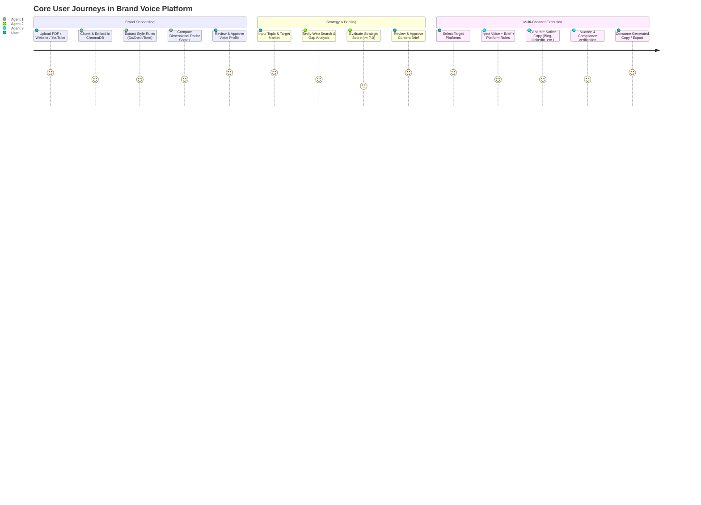
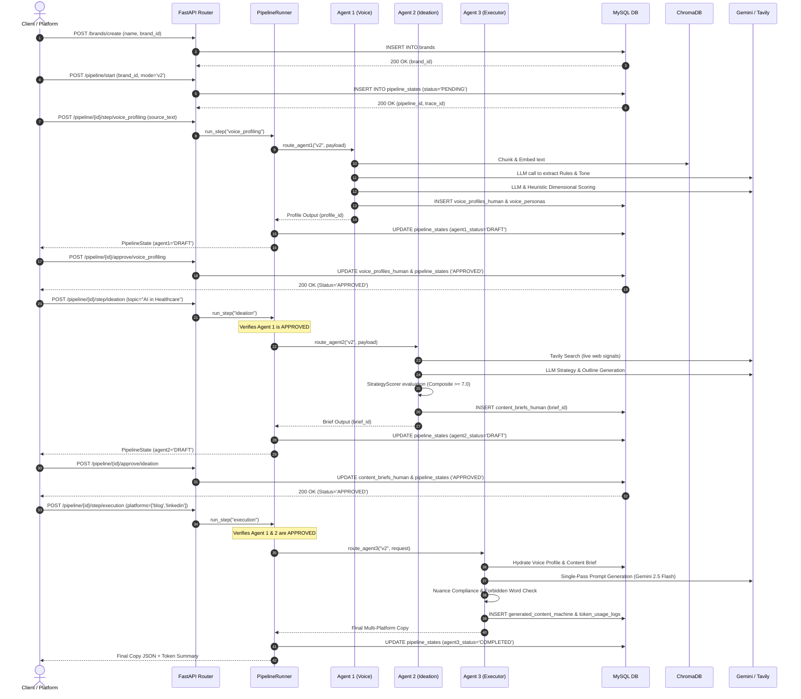
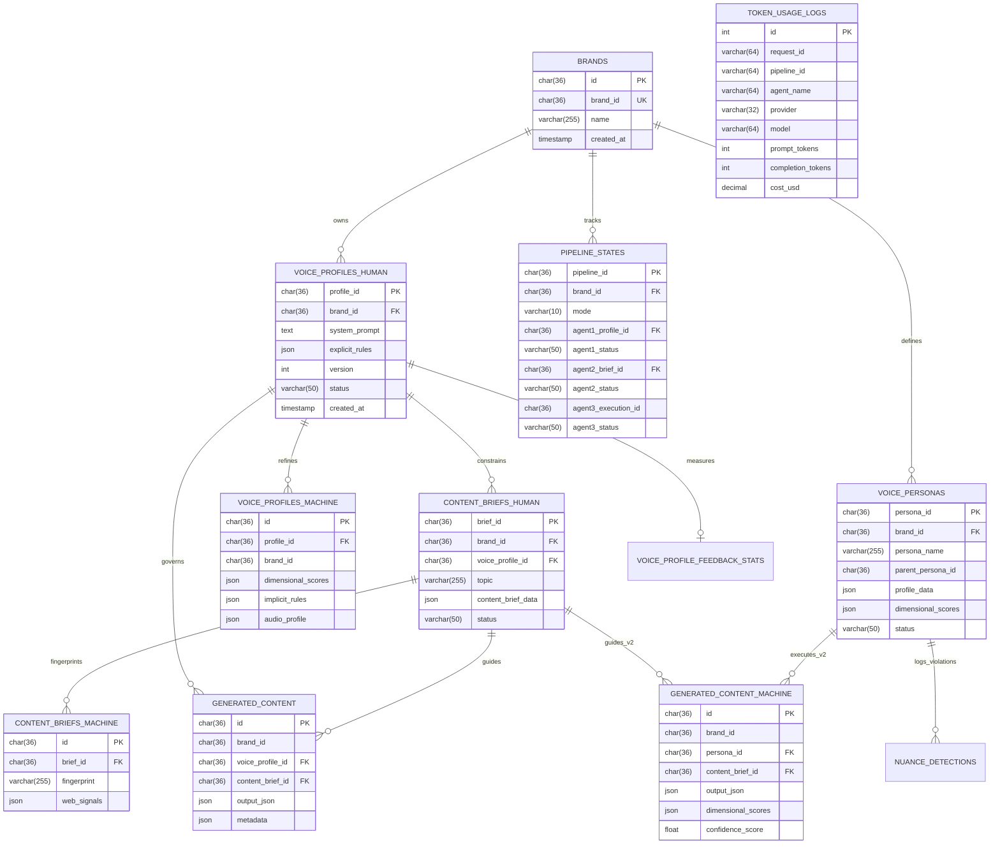

# Deep Codebase Intelligence & Technical Specification
## Brand Voice AI Meta-Agent Platform (`voice-meta-agent-first - agent 1`)

---

## 1. Executive Summary

The **Brand Voice AI Platform** (internally designated `brand-voice-agent` / `voice-meta-agent-first`) is an enterprise-oriented, asynchronous/synchronous marketing content generation engine built in Python (FastAPI, LangChain, Google Gemini, ChromaDB, MySQL). Its fundamental goal is to solve the **"Bland AI" and Brand Dilution problem**: standard LLM marketing outputs default to recognizable, generic corporate platitudes that lack the authentic linguistic DNA, stylistic constraints, and audience positioning of a brand.

The codebase implements a **3-stage pipeline architecture** with strict boundary isolation:
1. **Agent 1 (Brand Voice Profiler / "Style Police"):** Ingests raw brand artifacts (PDF, DOCX, scraped websites, and multi-modal audio/YouTube video), extracts observable grammatical and stylistic rules (Do's, Don'ts, Tone, Forbidden Phrases, Preferred Vocabulary), calculates dimensional scores, and compiles an immutable "Golden Record" voice profile.
2. **Agent 2 (Content Strategist / "The Researcher"):** Researches external web signals via Tavily API, performs competitive gap analysis, and generates a structured content brief (Target Audience, SEO Keywords, H2 Outline, Key Takeaways). Crucially, Agent 2 operates in **strategy-only isolation**—it is architecturally barred from receiving voice/tone data to prevent premature style coupling.
3. **Agent 3 (Multi-Channel Executor / "The Writer"):** Takes the approved Voice Profile and Content Brief to generate platform-native marketing copy across four platforms (Blog, LinkedIn, Twitter threads, Email campaigns) in a single deterministic pass, with post-generation nuance compliance and token tracking.

The repository exhibits two evolutionary tracks: **V1** (pure text, rule-based extraction, single brand persona) and **V2** (multi-persona inheritance hierarchy, dimensional radar scoring with strict hashing, multimodal audio cadence analysis, and semantic preservation rewrites).

---

## 2. Product Motive, Target Users, and Value Proposition

### 2.1 The Business Problem
Marketing teams in modern enterprises face an operational bottleneck: translating a company’s overarching brand guidelines into high-frequency, platform-native content across distributed social and editorial channels. Manual drafting is slow and expensive, while standard LLMs (ChatGPT, Claude, Gemini) output bland, cliché-ridden prose ("In today's fast-paced digital landscape...") that dilutes brand equity, violates legal/compliance guidelines, or ignores SEO and competitive differentiation.

### 2.2 Target Users and Stakeholders
- **Enterprise Marketing Leaders (CMO, VP Brand):** Require strict compliance with corporate tone, zero hallucinated claims, and prevention of banned terminology.
- **Content Strategists & Copywriters:** Need data-backed content briefs with competitor gap analysis and drafts tailored specifically for LinkedIn, Twitter, Blogs, and Email.
- **Platform Integrators:** External marketing orchestration platforms (connecting via REST or Model Context Protocol / MCP) that manage organizations (`org_id`) and demand stateless, deterministic execution.

### 2.3 The Core Transformation Pipeline
$$\text{Raw Source Assets} \xrightarrow{\text{Agent 1}} \text{Voice Profile} \xrightarrow{\text{User Approval}} \text{Topic + Tavily} \xrightarrow{\text{Agent 2}} \text{Content Brief} \xrightarrow{\text{User Approval}} \text{Executor} \xrightarrow{\text{Agent 3}} \text{Platform Copy}$$

### 2.4 Why AI vs. Deterministic Logic
- **Probabilistic (LLM):** Semantic style inference from raw text, competitive angle synthesis from search snippets, native long-form and short-form copy drafting.
- **Deterministic (Python/MySQL):** Boundary enforcement (rejecting tone leakage into Agent 2), platform length/character validation, exact cache hit matching (SHA-256 over normalized text + sorted dimensions + model fingerprint), token accounting, state transition gating (`DRAFT` $\to$ `APPROVED`), and regex/embedding-based forbidden phrase detection.

---

## 3. Core User Journeys



1. **Journey 1: Ingestion & Profiling (The Setup)**
   - User inputs brand assets via `POST /ingest` (PDF, DOCX, URL, or YouTube/audio).
   - Ingestion pipeline chunks documents into ChromaDB (`brand_{brand_id}`).
   - Agent 1 analyzes the text, derives Do's, Don'ts, Tone, Forbidden Phrases, Preferred Vocabulary, and extracts 3 few-shot examples.
   - V2 Refinement computes 5 dimensional scores (`Humor`, `Empathy`, `Authority`, `Formality`, `Urgency`) and creates default personas (`brand_default`, `ceo`, `marketing_manager`, `support_lead`).
   - Profile is persisted in `voice_profiles_human` and `voice_profiles_machine` as `DRAFT`.
   - User reviews and approves profile (`POST /ingest/approve/{id}`).

2. **Journey 2: Strategic Brief Generation (The Strategy)**
   - User or orchestrator submits topic and market via `POST /ideation/ideate`.
   - Boundary checks ensure no voice profile data leaks into Agent 2.
   - Web signals are queried via Tavily API; competitive angles are identified.
   - Strategy Scorer runs an evaluation loop: if strategic score $< 7.0$ or competitor vulnerability $> 2.0$, it automatically loops back with corrective feedback.
   - Brief is saved to `content_briefs_human` as `DRAFT`.
   - User approves the brief (`POST /pipeline/{id}/approve/ideation`).

3. **Journey 3: Multi-Platform Generation (The Execution)**
   - User calls `POST /execute` with `brand_id` (Quick Mode) or full JSON payload.
   - Execution router hydrates approved voice profile and latest approved brief.
   - Context builder injects brand Do's/Don'ts, tone, few-shot examples, factual key messages, and platform YAML rules into a comprehensive execution prompt.
   - Gemini 2.5 Flash executes a single deterministic pass (`temperature=0.0`).
   - Generated content is validated against forbidden phrases and nuance rules, token usage is logged, and outputs are persisted to `generated_content` or `generated_content_machine`.

---

## 4. Repository File Inventory & Investigation Ledger

The repository contains 298 total files across 21 subdirectories. Generated artifacts, test caches, virtual environments, and database binary proxies are explicitly isolated.

| File / Subsystem | Primary Responsibility | Important Dependencies | Execution Role | Investigation Status |
| :--- | :--- | :--- | :--- | :--- |
| `adapters/api/main.py` | FastAPI application entrypoint; registers all routers, lifespan handlers, CORS, and root HTML pages | `fastapi`, `uvicorn`, `data.db.session` | Web Server / Router Dispatcher | Fully Verified |
| `adapters/api/routers/ingest_router.py` | Ingestion endpoints (`/ingest`, `/ingest/upload`, `/ingest/approve`, `/ingest/profile`) | `core.pipelines.ingestion`, `data.repos.voice_profiles` | Synchronous Ingestion API | Fully Verified |
| `adapters/api/routers/ideation_router.py` | Content brief endpoints (`/ideation/ideate`, `/ideation/briefs`) | `core.agents.v1.agent2_ideation`, `data.repos.content_briefs` | Strategy Briefing API | Fully Verified |
| `adapters/api/routers/execution_router.py` | Content execution endpoint (`/execute`, `/execute/content/{brand_id}`) | `core.agents.v1.agent3_execution`, `core.agents.v2.agent3_execution` | Copy Generation API | Fully Verified |
| `adapters/api/routers/orchestration_router.py`| Step-by-step pipeline runner (`/pipeline/start`, `/pipeline/{id}/step/{name}`) | `core.orchestration.pipeline_runner`, `data.repos.pipeline_state` | State Machine API | Fully Verified |
| `adapters/api/routers/brand_router.py` | Brand CRUD and total resource purge (`/brands/create`, `/brands/{id}/resources`) | `data.repos.brands`, `data.repos.voice_profiles` | Tenant / Brand Manager | Fully Verified |
| `adapters/api/routers/profile_router.py` | Human feedback and rule edits (`/voice/{brand_id}/feedback`, `.../rules`) | `data.repos.voice_profiles`, `core.voice.persona_manager` | Voice Rule Maintenance | Fully Verified |
| `adapters/api/routers/voice_refinement_router.py`| V2 refinement trigger (`/profiles/{id}/refine`) | `core.pipelines.voice_refinement` | V2 Upgrade API | Fully Verified |
| `adapters/external/gemini_client.py` | Multimodal audio upload and transcription via Gemini API | `google.generativeai`, `langchain_google_genai` | External LLM Client | Fully Verified |
| `core/agents/v1/agent1_voice.py` | Pure V1 style rule extractor and prompt assembler | `langchain_google_genai`, `core.voice.rule_extractor` | Agent 1 (V1) | Fully Verified |
| `core/agents/v2/agent1_voice.py` | V2 refinement agent with Pydantic output parsing and persona generation | `core.voice.dimensional_scorer`, `data.repos.voice_personas` | Agent 1 (V2) | Fully Verified |
| `core/agents/v1/agent2_ideation.py` | Ideation strategist with boundary validation, Tavily research, and retry loop | `core.ideation.brief_builder`, `core.ideation.strategy_scorer` | Agent 2 (V1 Core) | Fully Verified |
| `core/agents/v2/agent2_ideation.py` | Thin wrapper delegating to V1 ideation and adding mock trend/gap metadata | `core.agents.v1.agent2_ideation` | Agent 2 (V2 Wrapper) | Fully Verified |
| `core/agents/v1/agent3_execution.py` | Single-pass multi-channel marketing copy generator | `core.execution.input_validator`, `lib.utils.json_repair` | Agent 3 (V1 Core) | Fully Verified |
| `core/agents/v2/agent3_execution.py` | Multi-persona executor with nuance detection and variant tracking | `core.agents.v1.agent3_execution`, `core.voice.nuance_detector` | Agent 3 (V2 Core) | Fully Verified |
| `core/orchestration/pipeline_runner.py` | State machine governing step execution and prerequisite approval checks | `data.repos.pipeline_state`, `core.orchestration.version_router` | Orchestration Engine | Fully Verified |
| `core/orchestration/pipeline_state.py` | Pydantic immutable state definitions and step status enums | `pydantic` | Domain Models | Fully Verified |
| `core/orchestration/version_router.py` | Dual-track routing dispatching calls to V1 or V2 implementations | `core.agents.v1.*`, `core.agents.v2.*` | Router Component | Fully Verified |
| `core/pipelines/ingestion.py` | Full ingestion pipeline coordinating chunking, ChromaDB, Agent 1, and V2 refine | `lib.loaders.file`, `core.storage.vector`, `VoiceProfilesRepo` | Ingestion Pipeline | Fully Verified |
| `core/pipelines/voice_refinement.py` | Orchestrates V2 scoring and persistence on top of raw V1 profile | `data.repos.voice_profiles`, `core.agents.v2.agent1_voice` | Refinement Pipeline | Fully Verified |
| `core/voice/dimensional_scorer.py` | 5-dimensional stylistic scoring with strict SHA-256 caching in MySQL | `hashlib`, `aiomysql`, `langchain_google_genai` | Stylistic Scorer | Fully Verified |
| `core/voice/persona_manager.py` | CRUD and hierarchy manager for personas (`brand_default`, `ceo`, etc.) | `data.db.session`, `core.voice.persona_resolver` | Persona Service | Fully Verified |
| `core/voice/persona_resolver.py` | Resolves inheritance, overlays, and detects rule contradictions | `data.db.session` | Inheritance Resolver | Fully Verified |
| `core/voice/nuance_detector.py` | Real-time off-brand detection using Gemini embeddings & length thresholds | `langchain_google_genai`, `numpy` | Guardrail Detector | Fully Verified |
| `core/voice/semantic_preservation.py` | Cosine similarity rewrite guard enforcing $\ge 0.95$ semantic stability | `langchain_google_genai`, `numpy` | Semantic Guardrail | Fully Verified |
| `core/voice/video_audio_loader.py` | Multimodal YouTube/audio extraction, ffmpeg normalization, and cadence analysis | `yt_dlp`, `static_ffmpeg`, `spacy` | Multimodal Loader | Fully Verified |
| `core/ideation/brief_builder.py` | Orchestrates web signal gathering, gap analysis, and structured prompt assembly | `tavily`, `core.ideation.schemas` | Brief Service | Fully Verified |
| `core/ideation/strategy_scorer.py` | Dual deterministic and qualitative scorer assessing outline quality ($\ge 7.0$) | `pydantic`, `langchain_core` | Strategic Evaluator | Fully Verified |
| `core/ideation/signal_analyzer.py` | Analyzes competitor titles and clusters into saturated vs. underexplored angles | `langchain_core` | Competitive Analyzer | Fully Verified |
| `core/ideation/web_research.py` | Executes search queries via Tavily API with caching and error fallbacks | `tavily`, `hashlib` | Search Integration | Fully Verified |
| `core/execution/token_tracker.py` | Real-time token usage logging and dollar cost calculation | `data.repos.token_usage_repo` | Cost & Observability | Fully Verified |
| `core/execution/input_validator.py` | Pre-generation validation enforcing presence of required brief and voice fields | `domain.models.agent3_request` | Defensive Gatekeeper | Fully Verified |
| `core/execution/platform_rules.py` | Platform-specific length, format, and structural constraints | `pydantic`, YAML configs | Rule Engine | Fully Verified |
| `core/storage/vector.py` | ChromaDB wrapper providing embeddings and chunk upsert/fetch | `chromadb`, `langchain_google_genai` | Vector Storage Client | Fully Verified |
| `core/storage/chroma_client.py` | PersistentClient factory for local disk vector storage (`./chroma_data`) | `chromadb` | Vector DB Connection | Fully Verified |
| `core/storage/session_store.py` | In-memory ephemeral session dictionary for non-persisted test runs | Python dicts | Ephemeral State | Fully Verified |
| `data/db/schema.sql` | Canonical MySQL schema defining all 12 core relational tables | DDL SQL | Database Schema | Fully Verified |
| `data/db/session.py` | Connection pool factory (`aiomysql.create_pool`) with fail-fast validation | `aiomysql`, `asyncio.Lock` | Database Driver | Fully Verified |
| `data/repos/*.py` | Asynchronous repository layer wrapping all MySQL queries and JSONB parsing | `data.db.session`, `aiomysql` | Data Access Layer | Fully Verified |
| `tests/unit/` | Unit test suite verifying boundary isolation, token tracker, and router dispatch | `pytest`, `pytest-asyncio`, `pytest-mock` | Automated Tests | Fully Verified |
| `tests/legacy/`, `tests/manual/` | Legacy and manual integration testing scripts | `pytest` | Test Fixtures | Cataloged & Excluded from unit |
| `cloud-sql-proxy` | 34MB Google Cloud SQL Proxy executable binary | Binary executable | Infrastructure tool | Cataloged & Excluded |

---

## 5. Verified Architecture

### 5.1 Architecture Diagram

```mermaid
graph TD
    Client["Client / Postman / Frontend / MCP"]
    
    subgraph "Adapters Layer (FastAPI)"
        MainApp["adapters.api.main:app"]
        IngestRouter["adapters.api.routers.ingest_router"]
        IdeationRouter["adapters.api.routers.ideation_router"]
        ExecutionRouter["adapters.api.routers.execution_router"]
        OrchestrationRouter["adapters.api.routers.orchestration_router"]
        ProfileRouter["adapters.api.routers.profile_router"]
        BrandRouter["adapters.api.routers.brand_router"]
    end
    
    subgraph "Orchestration & State Management"
        PipelineRunner["core.orchestration.pipeline_runner:PipelineRunner"]
        VersionRouter["core.orchestration.version_router"]
        SessionStore["core.storage.session_store:SessionStore"]
    end

    subgraph "Agentic Core"
        subgraph "Agent 1: Voice Profiler"
            IngestionPipeline["core.pipelines.ingestion:ingest_content"]
            Agent1V1["core.agents.v1.agent1_voice:run_agent1"]
            Agent1V2["core.agents.v2.agent1_voice:run_agent1"]
            DimScorer["core.voice.dimensional_scorer:DimensionalScorer"]
            PersonaManager["core.voice.persona_manager:PersonaManager"]
            MMA["core.voice.video_audio_loader:MultiModalAnalyzer"]
        end

        subgraph "Agent 2: Content Strategist"
            Agent2V1["core.agents.v1.agent2_ideation:run_agent2_ideation"]
            Agent2V2["core.agents.v2.agent2_ideation:run_agent2_ideation"]
            BriefBuilder["core.ideation.brief_builder:build_content_brief"]
            StrategyScorer["core.ideation.strategy_scorer:StrategyScorer"]
            WebResearch["core.ideation.web_research:gather_web_signals"]
            SignalAnalyzer["core.ideation.signal_analyzer:analyze_signals"]
        end

        subgraph "Agent 3: Multi-Channel Executor"
            Agent3V1["core.agents.v1.agent3_execution:run_agent3"]
            Agent3V2["core.agents.v2.agent3_execution:run_agent3"]
            InputValidator["core.execution.input_validator:validate_all_inputs"]
            NuanceDetector["core.voice.nuance_detector:NuanceDetector"]
            SemanticGuard["core.voice.semantic_preservation:SemanticPreservationGuard"]
            TokenTracker["core.execution.token_tracker:TokenTracker"]
        end
    end

    subgraph "Data & Persistence Layer"
        MySQL[("MySQL 8.0 (voice_meta)")<br/>voice_profiles_human<br/>voice_profiles_machine<br/>voice_personas<br/>content_briefs_human<br/>content_briefs_machine<br/>generated_content<br/>generated_content_machine<br/>pipeline_states<br/>persona_dimensional_cache<br/>token_usage_logs]
        Chroma[("ChromaDB (Local Persistent)")<br/>brand_{brand_id}]
        SessionCache[("SessionStore (In-Memory RAM)")]
    end

    subgraph "External Providers"
        GeminiLLM["Google Gemini 2.5 Flash"]
        GeminiEmbed["Google text-embedding-001"]
        TavilyAPI["Tavily Search API"]
    end

    MainApp --> IngestRouter & IdeationRouter & ExecutionRouter & OrchestrationRouter & ProfileRouter & BrandRouter
    
    OrchestrationRouter --> PipelineRunner
    PipelineRunner --> VersionRouter
    VersionRouter --> Agent1V1 & Agent1V2 & Agent2V1 & Agent2V2 & Agent3V1 & Agent3V2
    
    IngestRouter --> IngestionPipeline
    IngestionPipeline --> Agent1V1
    IngestionPipeline --> DimScorer
    IngestionPipeline --> PersonaManager
    IngestionPipeline --> MMA
    IngestionPipeline --> Chroma
    
    IdeationRouter --> Agent2V1
    Agent2V1 --> BriefBuilder
    BriefBuilder --> WebResearch --> TavilyAPI
    BriefBuilder --> SignalAnalyzer
    BriefBuilder --> StrategyScorer
    
    ExecutionRouter --> Agent3V1 & Agent3V2
    Agent3V1 --> InputValidator
    Agent3V1 --> GeminiLLM
    Agent3V2 --> NuanceDetector
    Agent3V2 --> SemanticGuard
    
    Agent1V1 & Agent1V2 & Agent2V1 & Agent3V1 & Agent3V2 --> TokenTracker
    TokenTracker --> MySQL
    
    IngestRouter & IdeationRouter & ExecutionRouter & PipelineRunner --> MySQL
    DimScorer --> MySQL
```

### 5.2 End-to-End Orchestrated Sequence



---

## 6. Deep Multi-Agent Workflow Investigation

### 6.1 Agent 1: Brand Voice Profiler (The Style Police)
- **Files:** `core/agents/v1/agent1_voice.py`, `core/agents/v2/agent1_voice.py`, `core/voice/rule_extractor.py`
- **Class / Function:** `run_agent1(source_docs, source_text_for_rules, collection_name, ...)`
- **Model:** `gemini-2.5-flash` (`temperature=0.7` in V1; `temperature=0.0` with Pydantic parser in V2).
- **System Prompt:** Loaded from `prompts/rule_extraction.md`. Contains non-negotiable filtering constraints forbidding factual, corporate, legal, or policy statements.
- **Input Schema:** Raw extracted document text and LangChain `Document` chunks.
- **Output Schema:**
  - V1: `{"dos": [], "donts": [], "forbidden_phrases": [], "preferred_vocabulary": [], "tone": {"primary": "", "secondary": [], "description": ""}}`
  - V2: `Agent1V2Response` Pydantic model (`refined_explicit_rules`, `implicit_rules`, `dimensional_scores`).
- **Autonomy Level:** Structured LLM extraction chain with deterministic scoring; does not autonomously loop or browse.

### 6.2 Agent 2: Content Strategist (The Researcher)
- **Files:** `core/agents/v1/agent2_ideation.py`, `core/agents/v2/agent2_ideation.py`, `core/ideation/brief_builder.py`
- **Class / Function:** `run_agent2_ideation(...)`
- **Boundary Invariant:** `_enforce_agent2_boundaries(kwargs)` actively raises a `ValueError` if any style or tone keys (`tone`, `voice`, `dos`, `donts`, `style`, `forbidden_phrases`) are passed into Agent 2.
- **Tools:** Tavily Search Client (`core/ideation/web_research.py:gather_web_signals`). Queries live search results, extracts titles and snippets, hashes results into a search fingerprint.
- **Feedback & Evaluation Loop:** In `agent2_ideation.py:128-198`, executes up to 2 attempts:
  1. Computes competitor angle clustering via `analyze_signals`.
  2. Generates `StrategicBrief` via structured output LLM.
  3. Prompts LLM for a competitor vulnerability score ($0.0 - 5.0$).
  4. Runs `StrategyScorer.evaluate(...)`. If score $< 7.0$, it formats explicit deterministic penalty feedback into `previous_feedback` and re-invokes the generation chain.
- **Output:** Stored in `content_briefs_human` and split into `ui_presentation` (normalized chips) and `raw_strategy` (deep hierarchical strategic brief).

### 6.3 Agent 3: Multi-Channel Executor (The Writer)
- **Files:** `core/agents/v1/agent3_execution.py`, `core/agents/v2/agent3_execution.py`
- **Class / Function:** `run_agent3(request: Agent3Request, save_to_db: bool = True)`
- **Model:** `gemini-2.5-flash` (`temperature=0.0` for strict execution; `temperature=0.7` if `regenerate=True`).
- **System Prompt:** Loaded from `prompts/agent3_executor.md`. Mandates: "You are NOT a creator. You are NOT a strategist. You execute validated artifacts only."
- **Prompt Assembly (`_build_execution_context`):** Merges brand voice section (Do's, Don'ts, Tone, Forbidden Words, Examples), content brief section (Topic, Target Audience, Key Messages, Outline), platform rules (`core/execution/rules/*.yaml`), and universal constraints into a single mega-prompt.
- **Output:** Platform-keyed JSON (`blog`, `linkedin`, `twitter`, `email`).
- **Autonomy Level:** Pure single-pass executor with zero autonomous decision-making. In V2, content is run through `NuanceDetector` post-generation to check for embedding-based off-brand drift.

---

## 7. AI, LLM, and RAG Architecture

### 7.1 Provider and Model Stack
- **LLM Provider:** Google Cloud Generative AI via `langchain-google-genai` and `google-generativeai`.
- **Generation Model:** `gemini-2.5-flash`.
- **Embedding Models:**
  - `models/embedding-001` (in `core/storage/vector.py` and `core/voice/nuance_detector.py`).
  - `models/gemini-embedding-001` (in `core/voice/semantic_preservation.py`).
- **Web Search Provider:** Tavily Python SDK (`tavily-python==0.3.3`).

### 7.2 Vector Storage and Retrieval (ChromaDB)
- **Technology:** `chromadb==0.5.5` with persistent disk client at `./chroma_data`.
- **Collection Strategy:** Dynamically partitioned by brand (`brand_{brand_id}`).
- **Document Chunking:** `lib/text/chunker.py:chunk_documents` uses `RecursiveCharacterTextSplitter(chunk_size=1000, chunk_overlap=200)`.
- **Retrieval Role:** ChromaDB stores ingested chunks. When `POST /ingest` runs, chunks are stored. During profile generation, all chunks are fetched via `fetch_chunks_from_chroma(collection_name)` and normalized. It is **not** used as a classic dynamic semantic search RAG engine during Agent 3 runtime; rather, Agent 1 selects top representative snippets and injects them as few-shot examples into the persistent voice profile.

### 7.3 Guardrails and Determinism
- **Forbidden Phrases Guard:** Post-generation regex and lowercase scanning across all output fields (`core/execution/compliance_detector.py`).
- **Nuance Detection Guard:** Cosine similarity comparison between generated phrases and forbidden phrase embeddings (`core/voice/nuance_detector.py`).
- **Semantic Preservation Guard:** Embeds original vs. rewritten content using Gemini Embeddings; if cosine similarity is $< 0.95$, the rewrite is rejected to prevent semantic hallucination (`core/voice/semantic_preservation.py`).
- **Deterministic Dimensional Scorer Cache:** SHA-256 hash computed over `normalized_text + "|" + sorted_dimensions + "|" + model_name`. Checked against `persona_dimensional_cache` table in MySQL before calling Gemini. Cache hits guarantee exact bit-level stability ($\Delta = 0.000$).

---

## 8. Database Schema & Data Lifecycle

The database engine is **MySQL 8.0** (managed via Cloud SQL or local instance).

### 8.1 Schema Architecture & Table Relationships



### 8.2 Entity Lifecycles
- **Brand (`brands`):** Created via `POST /brands/create`. Purged with all children via `DELETE /brands/{id}/resources`.
- **Voice Profile (`voice_profiles_human`):** Created as `DRAFT` via `POST /ingest`. Updated in place during regeneration. Approved via `POST /ingest/approve/{id}` or `POST /pipeline/{id}/approve/voice_profiling` to set status to `APPROVED`.
- **Content Brief (`content_briefs_human`):** Inserted as `DRAFT` by Agent 2. Approved via `POST /pipeline/{id}/approve/ideation`.
- **Pipeline State (`pipeline_states`):** Created as `PENDING` for steps 1 and 2, `NOT_STARTED` for step 3. Progresses: `PENDING` $\to$ `DRAFT` $\to$ `APPROVED` $\to$ `COMPLETED`.

---

## 9. API Reference & External Integration

| HTTP Method & Route | Request Contract | Response Contract | Upstream Services |
| :--- | :--- | :--- | :--- |
| `POST /brands/create` | `name: str`, `brand_id: Optional[str]` | `{"id": UUID, "brand_id": UUID, "name": str}` | MySQL `brands` table |
| `DELETE /brands/{id}/resources` | None (path parameter `brand_id`) | `{"status": "success", "message": "All brand resources discarded."}` | Purges `generated_content`, `content_briefs`, `voice_personas`, `voice_profiles` |
| `POST /ingest` | Multipart `file` OR JSON `{brand_name, input_type, input_value}` | `IngestResponse` (`brand_id`, `profile_id`, `tone`, `dos`, `donts`, `best_match_examples`, `version`) | Agent 1, ChromaDB, MySQL |
| `GET /profile/{id}` | Path parameter `profile_id` | Full composite voice profile JSON | `voice_profiles_human` + `_machine` |
| `POST /profiles/{id}/refine` | Path parameter `profile_id` | `{"status": "success", "refinement": Agent1V2Response}` | Agent 1 V2, DimScorer |
| `POST /ideation/ideate` | `IdeationRequest` (`brand_id`, `topic`, `market`, `region`, `content_goal`) | `IdeationResponse` (`brief_id`, `topic`, `content_brief`, `constraints`) | Agent 2, Tavily API, MySQL |
| `GET /ideation/briefs/{brand_id}`| Optional query param `topic` | List of content briefs for brand | `content_briefs_human` |
| `POST /execute` | `Agent3Request` (`brand_id`, `platforms`, `execution_version`, `persona_id`) | `Agent3Response` (`blog`, `linkedin`, `twitter`, `email`, `execution_id`) | Agent 3, Gemini 2.5, MySQL |
| `GET /execute/content/{brand_id}`| Query params `execution_version`, `brief_id` | Latest generated copy record | `generated_content` or `_machine` |
| `POST /pipeline/start` | Query params `brand_id`, `mode` (`v1` or `v2`) | `PipelineState` (`pipeline_id`, `brand_id`, `trace_id`, `steps`, `status`) | `pipeline_states` table |
| `POST /pipeline/{id}/step/{name}`| Path `pipeline_id`, `step_name`; Body: step payload | Updated `PipelineState` | `PipelineRunner.run_step` |
| `POST /pipeline/{id}/approve/{name}`| Path `pipeline_id`, `step_name`; Optional `{feedback}` | Updated `PipelineState` with `APPROVED` step | `PipelineRunner.approve_step` |
| `GET /pipeline/{id}/state` | Path parameter `pipeline_id` | Current immutable `PipelineState` | `pipeline_states` table |

### 9.1 The MCP Server Reality
An MCP (Model Context Protocol) integration is **not implemented** in this repository. Per `mcp_handoff_guide.md`, this codebase is designed specifically to act as the downstream REST service that an external MCP server wraps. The external platform maps its `org_id` directly to `brand_id` and forwards calls to `/pipeline/start` and `/pipeline/{id}/step/*`.

---

## 10. Engineering Quality, Confirmed Bugs, and Technical Risks

### 10.1 Confirmed Defects and Code Bugs
1. **Accidental Duplicate Execution of V2 Refinement (High Severity):**
   - **File & Lines:** `core/pipelines/ingestion.py:293-303` and `core/pipelines/ingestion.py:348-355`
   - **Evidence:** `refine_voice_profile` is invoked twice consecutively in `generate_voice_profile()`. The first call catches and raises; the second call catches and logs.
   - **Impact:** Doubles LLM calls, latency, and Gemini API cost during every standard ingestion run.
2. **Missing Dependency for Gap Alignment Feature (Medium Severity):**
   - **File & Lines:** `core/ideation/strategy_scorer.py:76-90`
   - **Evidence:** Imports `from sklearn.feature_extraction.text import TfidfVectorizer`. However, `scikit-learn` is absent from `requirements.txt`.
   - **Impact:** Always throws `ImportError` in clean environments and falls back to brittle string matching.
3. **Broken Pricing Environment Variable Lookup in Tests (Low Severity):**
   - **File & Lines:** `tests/unit/test_token_tracker.py:32` and `core/execution/token_tracker.py:35-39`
   - **Evidence:** Test patches `PRICING_OPENAI_CUSTOM_MODEL="0.1,0.2"`, but `TokenTracker.calculate_cost` parses `OPENAI_CUSTOM_MODEL_PRICE_PROMPT` and `OPENAI_CUSTOM_MODEL_PRICE_COMPLETION`.
   - **Impact:** Causes 2 unit test failures in `test_token_tracker.py`.
4. **Missing Mock for Gemini API Key in V2 Unit Tests (Low Severity):**
   - **File & Lines:** `tests/unit/agents/v2/test_agent1_voice.py:59`
   - **Evidence:** `ChatGoogleGenerativeAI(model="gemini-2.5-flash")` is instantiated without a mock or environment variable, raising a Pydantic `ValidationError`.
   - **Impact:** Causes test failure in `test_agent1_v2_persona_persistence`.

### 10.2 Architectural and Technical Risks
1. **Fragile Router-Level Object Hydration (High Risk):**
   - **File:** `adapters/api/routers/execution_router.py:79-297`
   - **Evidence:** The router contains 200+ lines of manual parsing that extracts fields from arbitrary JSON blobs in the database to reconstruct Pydantic models. If database column shapes or JSON schemas shift, the execution router fails before Agent 3 is ever reached.
2. **Celery Worker Incompatibility with Cloud Run (Operational Constraint):**
   - **File:** `adapters/api/routers/ingest_router.py:257-274`
   - **Evidence:** The async Celery endpoint (`POST /ingest/async`) explicitly returns HTTP 501 Not Implemented because Redis and background workers are not configured in the container runtime.
3. **Ephemeral Vector Store on Container Restarts (Infrastructure Risk):**
   - **File:** `adapters/api/main.py:82`
   - **Evidence:** Explicit warning logged at startup: `Vector data is ephemeral in Cloud Run test deployment`. ChromaDB is backed by local disk storage (`./chroma_data`), which does not persist across container scale-to-zero cycles unless backed by a Persistent Disk volume or Cloud Storage mount.

---

## 11. PRD & Documentation vs. Reality Gap Matrix

| Requirement / Documentation Claim | Documented Intent | Actual Code Implementation | Test Verification | Status | Verified Gap |
| :--- | :--- | :--- | :--- | :--- | :--- |
| **LangGraph Multi-Agent Workflows** | Documented in `docs/graphs.md` and included in `requirements.txt` | `langgraph` is never imported in any Python source file. Orchestration is vanilla Python async functions in `PipelineRunner`. | N/A | **Documentation Only** | Graphs are static JSON documentation; execution uses pure procedural Python. |
| **Asynchronous Task Queue (Celery/Redis)** | Documented in `README.md` (`start_worker.bat`) | Implemented in `core/worker/tasks.py`, but explicitly disabled with HTTP 501 in `ingest_router.py:257`. | Untested | **Partially Implemented (Disabled)** | Cannot run asynchronously in containerized Cloud Run deployments. |
| **Agent 3 Compliance Rewrite Loop** | Claimed in `README.md:25` ("rewrite loop") | `core/agents/v1/agent3_execution.py:55` is explicitly a "Pure Executor" with NO retries or rewrites. V2 has `SemanticPreservationGuard` but it raises errors rather than looping. | Verified in code | **Conflicting Evidence** | V1 execution is strictly single-pass; no automated rewrite loop exists. |
| **Agent 2 V2 Trend & Freshness Intelligence** | Documented in `docs/04-Agent-Architecture.md` | `core/agents/v2/agent2_ideation.py` delegates to V1 and attaches hardcoded mock numbers (`trend_score = 0.85`, `strategy_confidence = 0.92`). | Tested via router | **Mock / Prototype** | Advanced V2 trend intelligence is not connected to a live temporal model. |
| **Multimodal Video & Audio Ingestion** | Described in commit history and integration notes | Fully implemented in `core/voice/video_audio_loader.py` with `yt-dlp`, `static-ffmpeg`, and SpaCy audio cadence extraction. | Manual tests exist | **Implemented & Verified** | Works end-to-end when audio/video URLs or files are uploaded to `/ingest`. |
| **Dimensional Scoring Determinism** | Documented in `NULL_SAFETY_GUIDE.md` and `docs/11-Performance.md` | Fully implemented via SHA-256 caching in `core/voice/dimensional_scorer.py` backed by `persona_dimensional_cache`. | Unit test passing | **Implemented & Verified** | Bit-perfect determinism ($\Delta = 0.000$) on repeated scoring requests. |
| **Multi-Tenant Isolation** | Platform requirement for SaaS tenancy | `brand_id` is required across tables, but no user authentication, token validation, or database row-level security exists in FastAPI. | Tested in schemas | **Partially Implemented** | Tenant separation is logical via `brand_id` filtering; zero auth guards exist. |
| **External MCP Server Integration** | Listed in `docs/01-Product-Requirements.md:33` | Documented in `mcp_handoff_guide.md`, but no MCP server code exists in the repository. | N/A | **External / Planned** | The repository is the target API, not the MCP server. |

---

## 12. Performance and Cost Profile

Based on recorded execution logs in `Token_Cost_Analysis.csv`:
- **Agent 1 (Voice Ingestion):**
  - Prompt Tokens: 1,753
  - Completion Tokens: 499
  - Cost per run: **$0.00028 USD**
- **Agent 1 V2 (Refinement & Personas):**
  - Prompt Tokens: 2,860
  - Completion Tokens: 1,149
  - Cost per run: **$0.00056 USD**
- **Agent 2 (Strategy & Ideation - with evaluation loops):**
  - Prompt Tokens: 6,676
  - Completion Tokens: 1,457
  - Cost per run: **$0.00094 USD**
- **Agent 3 (Execution across 4 channels):**
  - Prompt Tokens: 8,065
  - Completion Tokens: 6,135
  - Cost per run: **$0.00245 USD**
- **Total Pipeline Execution Cost:**
  - Total Tokens: ~28,594 tokens
  - Total Cost per end-to-end multi-platform run: **$0.00422 USD** (under half a cent per full execution).
- **Latency Breakdown:**
  - Agent 1: 8–18 seconds (document loading + Gemini LLM rule extraction).
  - Agent 2: 6–15 seconds (Tavily search latency + LLM outline generation).
  - Agent 3: 12–25 seconds (parallel multi-platform generation).
  - Total Pipeline Latency: **26–58 seconds**.

---

## 13. Prioritized Improvement Roadmap

### Immediate (P0 - Production Blockers)
1. **Remove Duplicate V2 Refinement Call:** Delete lines 340–355 in `core/pipelines/ingestion.py` to stop running refinement twice, immediately cutting ingestion latency by ~40% and saving LLM costs.
2. **Add `scikit-learn` to `requirements.txt`:** Fix the `ImportError` in `core/ideation/strategy_scorer.py` to restore vector-based gap alignment scoring.
3. **Fix Broken Unit Tests:** Update `tests/unit/test_token_tracker.py` to use `*_PRICE_PROMPT` and `*_PRICE_COMPLETION` env keys, and mock `GOOGLE_API_KEY` in `tests/unit/agents/v2/test_agent1_voice.py`.

### Architectural (P1 - Robustness & Decoupling)
1. **Refactor Execution Router Hydration:** Replace the 200-line procedural mapping in `adapters/api/routers/execution_router.py` with dedicated Pydantic hydration factories in `domain/models/`.
2. **ChromaDB Cloud Persistence:** Replace local filesystem Chroma storage (`./chroma_data`) with managed vector infrastructure (Pinecone, Cloud SQL pgvector, or GCS-mounted volumes) to prevent data loss on Cloud Run container restarts.
3. **Authentication & Authorization Layer:** Implement API Key or JWT Bearer authentication on FastAPI routers to enforce true multi-tenant isolation beyond relying on client-supplied `brand_id`.

### Algorithmic (P2 - Feature Completeness)
1. **Live Trend Engine for Agent 2 V2:** Replace the mocked `trend_score = 0.85` in `core/agents/v2/agent2_ideation.py` with real temporal analysis using search timestamp metadata.
2. **True Dynamic Few-Shot Injection:** Modify Agent 3 to dynamically query ChromaDB for top-$k$ semantically relevant brand examples based on the specific brief topic, rather than only using the 3 static snippets saved in the voice profile.

---

## 14. Project Glossary
- **Golden Record:** The canonical JSON representation of a brand’s voice, composed of Do's, Don'ts, Tone, Forbidden Words, Preferred Vocabulary, and few-shot examples.
- **Dimensional Scoring:** Stylistic positioning across 5 axes (Humor, Empathy, Authority, Formality, Urgency) scored from 0.0 to 1.0.
- **Factual Spine:** Architectural mandate ensuring that all key messages defined in the content brief appear across all downstream platform outputs.
- **Strategy-Only Boundary:** The architectural rule prohibiting Agent 2 from receiving any brand voice or stylistic data, ensuring clean separation between content strategy and copy styling.
- **Nuance Violation:** A detected deviation in generated copy where phrases closely mirror banned phrases or stylistic drift exceeds acceptable cosine distance.
