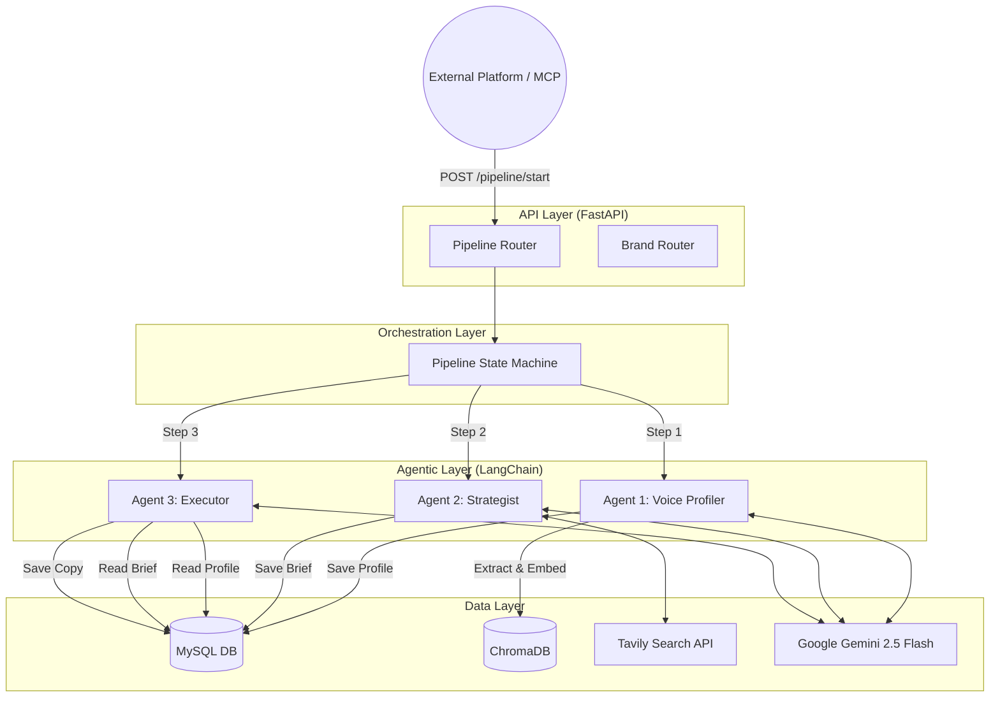

# System Architecture

## 1. High-Level Architecture
The Brand Voice Meta-Agent is designed as a centralized API backend (FastAPI) that orchestrates LangChain-based AI agents, vector storage (ChromaDB), and relational storage (MySQL).

## 2. Component Breakdown

### A. The API Layer (`adapters/api/`)
- Built with **FastAPI** running on `uvicorn`.
- Exposes synchronous endpoints for brand management, profile ingestion, and pipeline orchestration.
- **Design Philosophy:** The API acts as the "State Manager". It doesn't run agents arbitrarily; it enforces the strict `Agent 1 -> Agent 2 -> Agent 3` pipeline flow.

### B. The Agentic Layer (`core/agents/`)
- Built heavily on **LangChain**.
- **Agent 1 (`voice/`)**: Uses document loaders to ingest PDFs/URLs, splits text, and prompts the LLM to extract tone, vocabulary, and "do's and don'ts." It generates a structured `v2` profile containing `dimensional_scores` (for radar charts).
- **Agent 2 (`ideation/`)**: Connects to the **Tavily API** to research the web. It synthesizes findings into a strategic JSON brief (Target Audience, SEO Keywords, H2 Outline).
- **Agent 3 (`execution/`)**: Takes the outputs of Agents 1 & 2. It contains sub-prompts tailored to specific platforms (e.g., LinkedIn vs. Twitter) to generate native copy while strictly applying the voice rules.

### C. The Data Layer (`data/`)
- **MySQL**: The primary source of truth. Stores `brands`, `voice_profiles`, `content_briefs`, and `generated_content`. Handles the state tracking of the pipeline.
- **ChromaDB**: A local vector store used by Agent 1 to embed and retrieve semantic examples of the brand's voice for Few-Shot prompting during Agent 3's execution phase.
