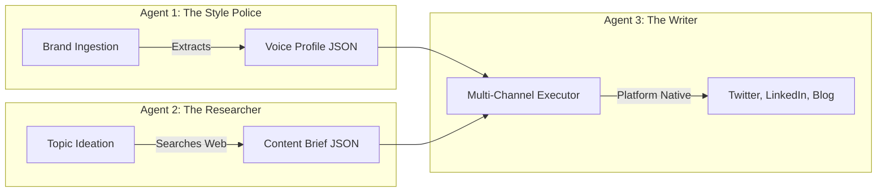

# Agent Architecture

## 1. The "Meta-Agent" Concept

Most AI systems rely on a single, massive prompt given to one LLM (e.g., "Act as a marketer, learn this brand, research this topic, and write a tweet"). This results in context window dilution, hallucination, and generic output.

The **Brand Voice Meta-Agent** utilizes a strict **Sequential Handoff Architecture**. By breaking the task into three separate agents, we isolate contexts and allow for deterministic human-in-the-loop approvals between steps.

## 2. Agent 1: Brand Voice Profiler
- **Objective:** Establish the ground-truth persona.
- **Input:** PDFs, URLs, raw text.
- **Process:** LangChain document loaders parse the input. A specialized prompt instructs Gemini to act as a linguistic analyst, extracting:
  - `tone_descriptors` (e.g., "Authoritative, Witty")
  - `vocabulary_rules` (e.g., "Always say 'Clients', never 'Customers'")
  - `dimensional_scores` (For UI rendering)
- **Output:** A strict Pydantic model serialized to MySQL.

## 3. Agent 2: Content Strategist
- **Objective:** Ensure the content has substance, preventing "fluff."
- **Input:** A user-provided topic (e.g., "The future of AI").
- **Process:** Calls the **Tavily API** to research the topic, identifying current trends, competitor angles, and high-value SEO keywords.
- **Output:** A strategic JSON brief detailing target audience pain points, primary messages, and an H2 structure.

## 4. Agent 3: Multi-Channel Executor
- **Objective:** Generate the final copy.
- **Input:** Voice Profile (from Agent 1) + Content Brief (from Agent 2).
- **Process:** Uses parallel processing (via `asyncio`) to generate content for multiple platforms simultaneously. It applies specialized prompts per platform (e.g., the Twitter prompt strictly limits length and dictates thread structure, while the Blog prompt focuses on SEO density and H2 pacing).
- **Validation Loop:** Agent 3 contains an internal self-reflection step. Before returning the copy, it compares the output against the `vocabulary_rules` from Agent 1. If a banned word is found, it rewrites the text automatically.
