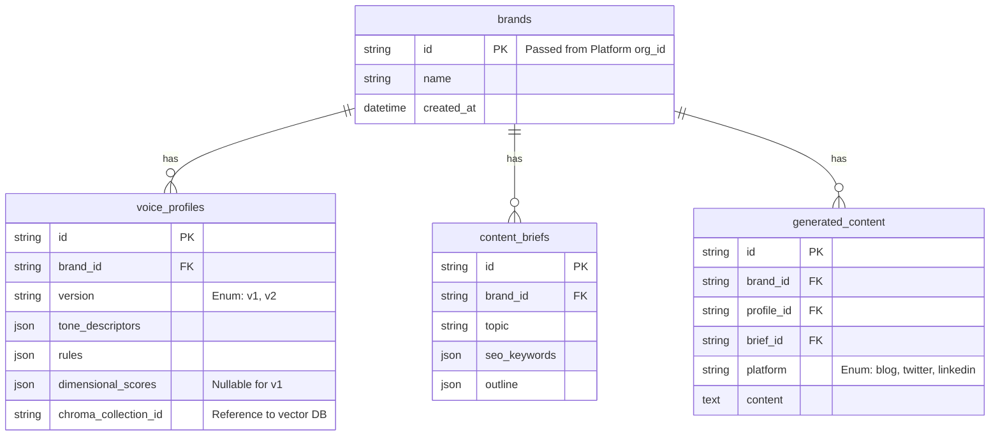

# Database Design

The system relies on MySQL for state persistence and relational mapping, supplemented by ChromaDB for semantic vector search.

## 1. MySQL Relational Schema

## 2. ChromaDB (Vector Store)

To capture the *implicit* stylistic nuances of a brand (which are hard to define in rigid rules), Agent 1 creates a ChromaDB collection for each `brand_id`.
- **Embedding Model:** `text-embedding-004` (Google)
- **Process:** Brand PDFs/URLs are chunked into 500-token segments and embedded.
- **Usage:** During Agent 3's execution, the LLM queries ChromaDB for the 3 most stylistically relevant chunks to use as few-shot examples in its system prompt.
