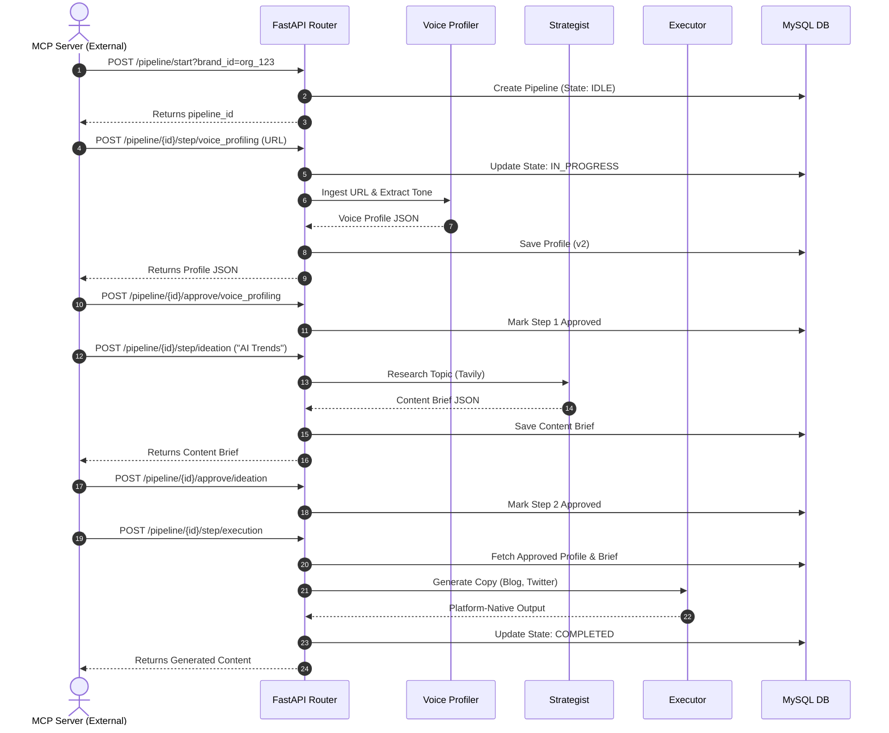

# Execution Flow

This sequence diagram illustrates the strict state machine flow orchestrated via the REST API, simulating an external platform (via MCP) executing the full Meta-Agent pipeline.

## Critical Flow Constraints
- **Idempotency:** Agent 2 (Ideation) uses fingerprint-based deduplication. If called twice with the exact same topic and market, it returns the cached result to save API costs.
- **Blocking Protection:** Agent 3 (Execution) is **NOT** safe to retry automatically, as it incurs expensive LLM calls. The external platform must handle timeouts (which should be set to >= 45s).
