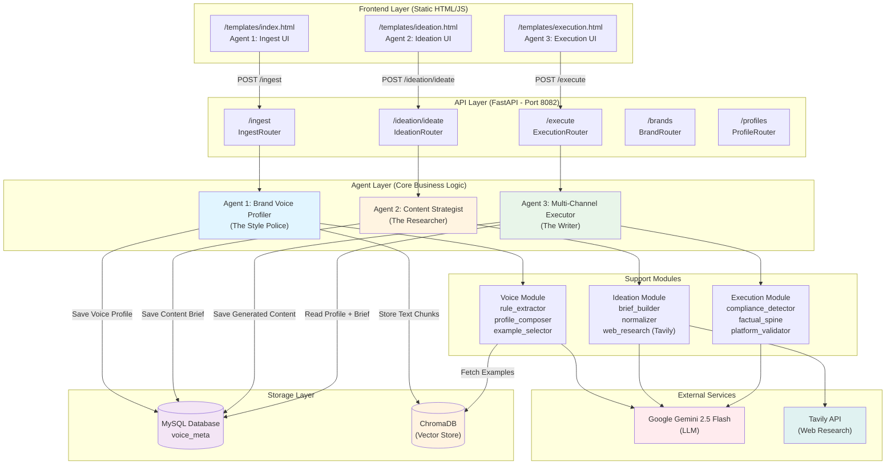
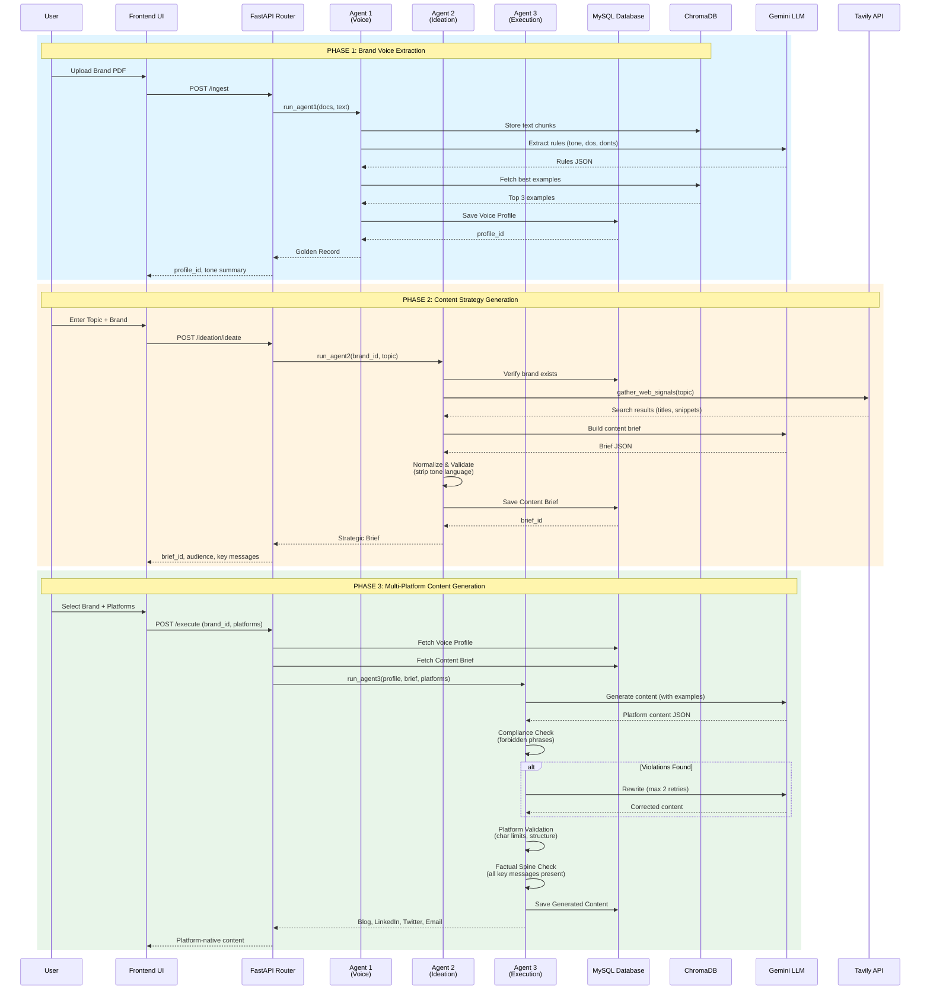
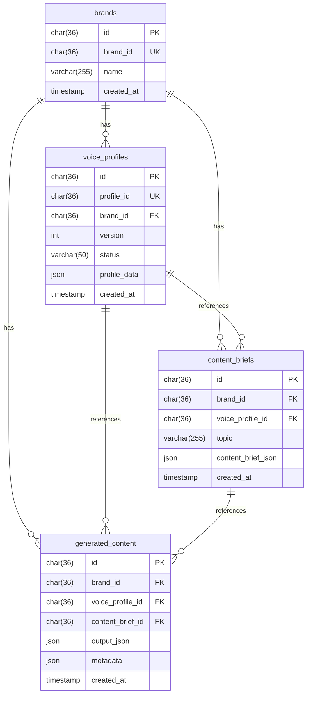
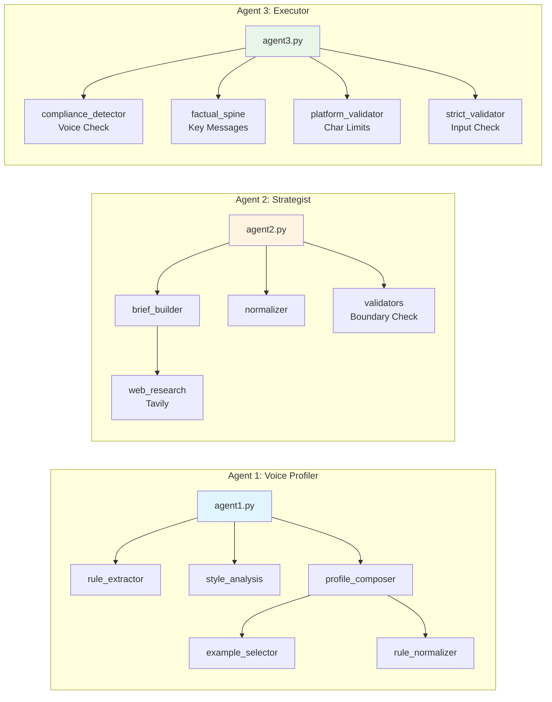
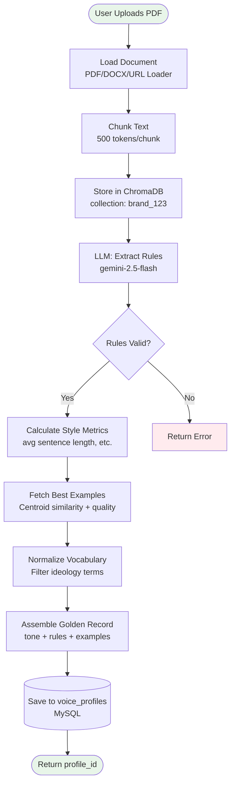
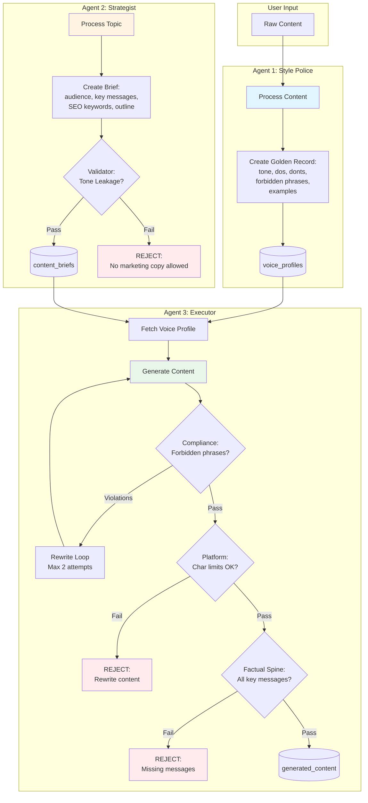
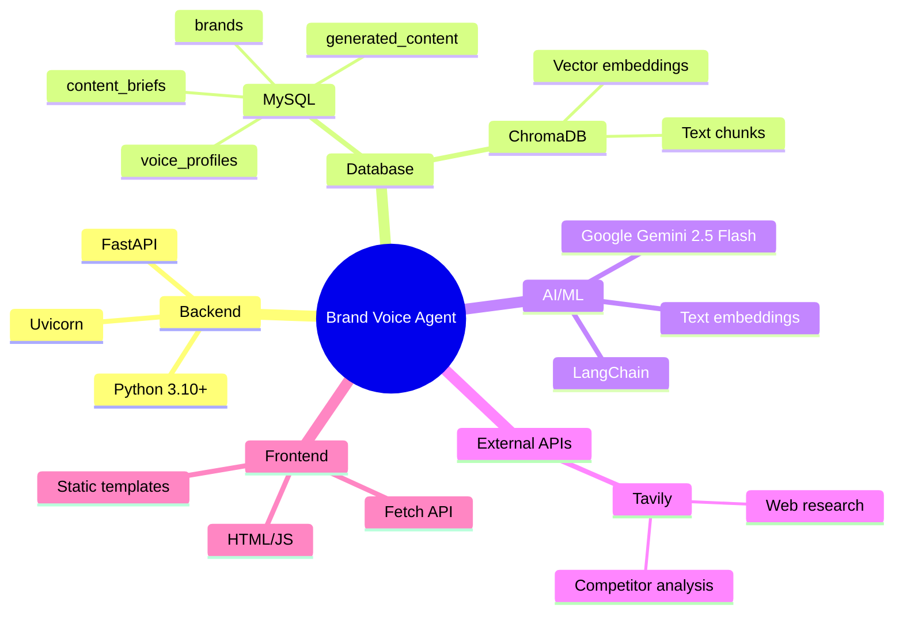

# Brand Voice Agent - Architecture Diagram

## System Overview

---

## Agent Pipeline Flow

---

## Database Schema

---

## Component Interaction Map

---

## Data Flow: Golden Record Creation

---

## Boundary Enforcement Architecture

---

## Technology Stack

